<!-- ════════════════════════════════════════════════════════════════ -->
<!-- tmqahihi · TÔN MINH QUÂN · Cybersecurity Researcher        -->
<!-- Theme: NEON CYBERDECK · terminal aesthetic                       -->
<!-- ════════════════════════════════════════════════════════════════ -->

  

 

  

 

  

 

  

 

<!-- ─── TELEMETRY / DETECTION RADAR ────────────────────────────── -->

  

 

<!-- ─── STATS ──────────────────────────────────────────────────── -->

  

 

<!-- ─── LAB RIG & THREAT INFRASTRUCTURE ────────────────────────── -->

  

 

<!-- ─── CONTRIBUTION STREAM ────────────────────────────────────── -->

  <picture>
    <source media="(prefers-color-scheme: dark)" srcset="https://raw.githubusercontent.com/tmqahihi/tmqahihi/output/github-snake-dark.svg">
    <source media="(prefers-color-scheme: light)" srcset="https://raw.githubusercontent.com/tmqahihi/tmqahihi/output/github-snake.svg">
    
  </picture>

<!-- ─── RESEARCH DISPATCHES ────────────────────────────────────── -->

  <code>tmqahihi@sec:~$ cat /var/log/dispatches.log --tail=4</code>

 

<!-- RESEARCH-DISPATCH:START -->
<pre><code>[DISPATCH 01] CVE/RESEARCH  :: Windows Internals & Direct Syscall Evasion (Halo/Tartarus Gate)
[DISPATCH 02] MEM-FORENSICS :: Patchless VEH Blinding & Hardware Breakpoints (DR0-DR3)
[DISPATCH 03] LAB-TELEMETRY :: Autonomous Zero-Residual Malware Triage Pipeline (FlareVM)
[DISPATCH 04] DEFENSE-OPSEC :: Synthetic Call Stack Spoofing & Return Address Camouflage</code></pre>
<i>Telemetry refreshed automatically via GitHub Actions Pipeline (2026-11-13 06:13 UTC)</i>
<!-- RESEARCH-DISPATCH:END -->

 

<!-- ─── CLASSIFIED DOSSIER // INTERACTIVE TERMINAL ───────────── -->

  

    
<code><b>[+] tmqahihi@sec:~$ gpg --decrypt ./classified_dossier.asc</b></code> <i>(Click to decrypt lab specs &amp; security assurance)</i>

     
    

      <pre><code>╔═══════════════════════════════════════════════════════════════════════════╗
║ [CLASSIFIED] THREAT RESEARCH &amp; ANALYSIS LAB SPECIFICATIONS                ║
╠═══════════════════════════════════════════════════════════════════════════╣
║ [+] Hypervisors   : Proxmox VE · VMware Workstation Pro · Bare Metal Type1║
║ [+] Analysis OS   : FlareVM (Win11 Ent) · REMnux v7 · Arch Linux Hardened ║
║ [+] Static/RE     : IDA Pro · Ghidra · Binary Ninja · PE-bear · CAPA      ║
║ [+] Dynamic/Debug : x64dbg · WinDbg Preview · Frida DBI · Process Hacker 2║
║ [+] Network Intel : Wireshark · Burp Suite Professional · Zeek IDS        ║
║ [+] Cryptography  : PGP Fingerprint: 9F8A 4E21 7B0C 3D88 1A2E 5F90 (4096R)║
║ [+] Security RFC  : RFC 9116 Vulnerability Disclosure Compliant           ║
║ [+] Policy Link   : github.com/tmqahihi/tmqahihi/.well-known/blob/main/security.txt║
╚═══════════════════════════════════════════════════════════════════════════╝</code></pre>
    

  

 

<!-- ─── CONNECT ────────────────────────────────────────────────── -->

  <code>tmqahihi@sec:~$ ./connect.sh</code>

 

  
  
  
  
  
    
  
  
  

 

  

